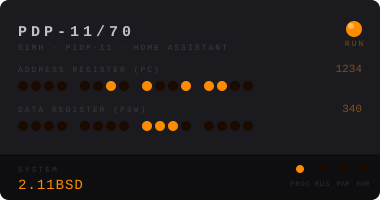

# PiDP-11 for Home Assistant

> *Lights that blink. Switches that matter. A 1975 computer that now lives in your smart home.*

Run the iconic [PiDP-11](https://obsolescence.wixsite.com/obsolescence/pidp-11) — Oscar Vermeulen's
beautiful reproduction of the PDP-11/70 front panel — on a Raspberry Pi 5 alongside
Home Assistant OS, and wire it up to your HA dashboard with live register displays,
CPU state sensors, and front-panel services.

Powered under the hood by [SimH](http://simh.trailing-edge.com/) via the
[obsolescence/pidp11](https://github.com/obsolescence/pidp11) distribution, with the
GPIO lamp driver running inside an HAOS Supervisor add-on container.

---

## Dashboard Card

Add the **PiDP-11 Front Panel** card to any Lovelace dashboard for a faithful
software replica of the physical PDP-11/70 front panel — real-time ADDRESS and DATA
LED rows, status indicators, SR toggle switches, rotary selector indicators, and
control buttons, all in the original dark panel color scheme.



The card auto-registers when you install the integration — no manual Lovelace resource
step needed. Just add it:

```yaml
type: custom:pidp11-panel-card
```

Or click **Add Card → PiDP-11 Front Panel** in the Lovelace card picker.

### What the lights mean

| Panel element | Source | What it shows |
|---------------|--------|---------------|
| **STATUS row** (12 LEDs) | CPU state / PSW | PAR ERR, ADRS ERR, RUN (on = running), PAUSE, MASTER; USER/SUPER/KERNEL (lit by CPU mode from PSW bits 15–14); ADDRESSING 16/18/22 (22 lit for PDP-11/70). |
| **ADDRESS** (22 LEDs) | `EXAMINE PC` — 20 Hz live | Program counter as 22 binary LEDs in groups `[1,3,3,3,3,3,3,3]` (bits 21–0, MSB left). Updates at up to 20 Hz via the lamp push stream on port 2226. |
| **DATA** (16 LEDs) | `EXAMINE PSW` — 20 Hz live | Processor status word as 16 binary LEDs in 4 groups of 4. Interrupt level in bits 7–5, condition codes in bits 3–0. Same 20 Hz stream as ADDRESS. |
| **PARITY H/L** | `PARITY_HIGH` / `PARITY_LOW` on the live feed | Lit from the live lamp feed when the add-on sends those lamps; dark otherwise (SimH does not expose parity). |
| **SR switches** (22) | `binary_sensor.pidp_11_sr0`–`sr21` | Physical SR switch positions, updated via the 250 ms SR events carried on the lamp stream (port 2226, `AUTH <secret> +sr`). Toggle-knob style; knob at top = ON. |
| **ADDR SELECT** | *(hardcoded)* | Shows PROG PHY active — always, because we EXAMINE PC. |
| **DATA SELECT** | *(hardcoded)* | Shows DISPLAY REGISTER active — always, because we EXAMINE PSW. |

ADDRESS and DATA LEDs animate at **up to 20 Hz** via the dedicated lamp stream (port 2226,
`_handle_lamp_stream` in the add-on). On each `pidp11_lamps` HA event the card calls
`requestAnimationFrame` and patches only the LED class list — no full re-render.
The 5 s coordinator tick still updates status indicators, CPU mode, system name, and SR
switch positions.

The current system name is read in an executor job, never on the event loop. When the
add-on runs on another machine, the integration asks it over the remote console with
`AUTH <secret> +system`, answered by `SYSTEM <name>`. The local file
`/share/pidp11/current_system` is only the same-machine fallback.

If the card shows no values, see [Troubleshooting](#troubleshooting).

### Optional entity overrides

The card defaults to the entity IDs the integration creates automatically. Override any
of them if you've renamed your device. The integration's device is called "PiDP-11", which
Home Assistant slugs to `pidp_11`, so every entity id starts with `pidp_11_`. If a
configured or default entity id is not found, the card also tries the older `pidp11` slug
and `_2` duplicates, so most installs need no overrides:

```yaml
type: custom:pidp11-panel-card
state_entity:    sensor.pidp_11_cpu_state
pc_entity:       sensor.pidp_11_pc
psw_entity:      sensor.pidp_11_psw
system_entity:   sensor.pidp_11_system
sr_prefix:       binary_sensor.pidp_11_sr    # appended with 0..21
cpu_mode_entity: sensor.pidp_11_cpu_mode
```

---

## What ships from this repo

Two artifacts in one repo, because HA distributes Python and containers through
different channels:

| Artifact | Channel | What it does |
|----------|---------|--------------|
| **`pidp11-addon/`** | Supervisor add-on or standalone Docker | Container running SimH + GPIO lamp/switch driver (`pidp1170_blinkenlightd`) + auth shim (port 2223) + lamp stream with SR events (port 2226; the older SR-only watch stream on 2225 remains for old clients) + mDNS advertisement + SSH console. |
| **`custom_components/pidp11/`** | HACS Integration | Python integration exposing HA entities, services, and the Lovelace card. Connects to the add-on over TCP (local `127.0.0.1:2223` or remote Pi IP via mDNS auto-discovery). |

The add-on includes a boot-select encoder: at startup it reads the front-panel SR
switches via `scansw` and boots the OS whose octal code matches the switch pattern
(e.g., SW0 up → `0001` → RSX-11M+). All-switches-down falls back to the `default_boot`
add-on option.

---

## Running without Home Assistant

Just want the blinking lights without HA? The same Docker image runs as a
standalone PDP-11 on any Raspberry Pi 5 with Docker installed — pull, run,
SSH in, enjoy.

```bash
docker run -d --name pidp11 --restart unless-stopped \
  --privileged --network host \
  -v /run/rpcbind.sock:/run/rpcbind.sock \
  -v /opt/pidp11-share:/share \
  -v pidp11-data:/data \
  -e ENABLE_GPIO=true \
  -e SSH_PASSWORD=pdp11 \
  -e SSH_PORT=2211 \
  ghcr.io/dmz006/pidp11-addon:latest
```

Full instructions, prerequisites, disk image staging, and OS boot table:
**[docs/standalone-docker.md](./docs/standalone-docker.md)**

Front panel controls, OS switch table, and shutdown procedures:
**[docs/front-panel.md](./docs/front-panel.md)**

---

## Supported topologies

### Topology A — Pi runs both the emulator and HAOS (add-on mode)

The Pi 5 runs **HAOS** directly (or HA Supervised). The PiDP-11 add-on installs inside
the Supervisor. The HACS integration talks to it on `127.0.0.1:2223`. This is the
simplest setup — everything on one board.

### Topology B — Pi runs the emulator; HAOS is on a separate machine

The Pi 5 runs **Docker standalone** with the PiDP-11 image. Your Home Assistant instance
is a VM, NUC, or another host on the same LAN. The HACS integration is installed on
that remote HA and connects to the Pi's IP on port 2223. mDNS/zeroconf auto-discovery
advertises the Pi on your LAN so HA finds it automatically.

Both topologies are fully supported. HAOS and HA Supervised both work in topology A.
HA Container and HA Core do not support add-ons and are only usable in topology B.

Hardware: **Raspberry Pi 5** with the PiDP-11 hat. The Pi 5 uses the RP1 I/O chip;
the GPIO driver has been tested and confirmed working (`/dev/gpiomem0`–`/dev/gpiomem4`).

---

## Quick install

### Topology A — Pi + HAOS (add-on mode)

1. Settings → Add-ons → Add-on Store → ⋮ → **Repositories** → paste `https://github.com/dmz006/pidp11-hacs`. Install **PiDP-11 Emulator**.
2. Add-on **Configuration** → set an `ssh_password` → **Start**.
3. Watch the add-on log: within ~30 s you should see `[pidp11] Starting SimH` and the
   physical lamps should begin blinking.
4. HACS → ⋮ → **Custom repositories** → add `https://github.com/dmz006/pidp11-hacs`, category *Integration*. Install **PiDP-11**.
5. Settings → Devices & Services → **Add Integration** → *PiDP-11*.
   - Host: `127.0.0.1` (add-on is reachable at localhost)
   - Port: `2223`
   - Shared secret: auto-detected from `/share/pidp11/remote_console.secret`
6. Open any Lovelace dashboard → **Edit** → **Add Card** → search *PiDP-11 Front Panel*.

### Topology B — Pi running Docker; HAOS on a separate host

1. On the Pi: follow **[docs/standalone-docker.md](./docs/standalone-docker.md)** to start
   the container. The add-on image advertises itself via mDNS and listens on port 2223.
2. On your HAOS VM / NUC:
   - HACS → ⋮ → **Custom repositories** → add `https://github.com/dmz006/pidp11-hacs`, category *Integration*. Install **PiDP-11**.
   - Restart HA.
3. HA should show **"New device found: PiDP-11"** within ~30 s (mDNS auto-discovery).
   Click **Configure**, enter the shared secret and you're done.

   **If the mDNS notification doesn't appear** (different subnets, or multicast blocked):
   Settings → Devices & Services → **Add Integration** → *PiDP-11* → enter the Pi's IP,
   port `2223`, and the shared secret manually.

   **To retrieve the secret from the Pi** (run this on the Pi itself, as a user that may use `sudo`):
   ```sh
   sudo docker exec pidp11 cat /data/remote_console.secret
   ```
   The secret is a 64-character hex string generated on the first start. The same value is
   copied to `/opt/pidp11-share/pidp11/remote_console.secret` (the container's `/share`).
   Both files are readable by root only. Do **not** use `ssh pdp11@<pi-ip> -p 2211 'cat ...'`:
   that account's shell is the PDP-11 console menu, it does not run your command and it could
   not read a root-only file anyway.

### Adding the device in Home Assistant

1. Install the **PiDP-11** integration through HACS and **restart Home Assistant**. The
   integration only appears under *Add Integration* after the restart.
2. Settings → Devices & Services → **Add Integration** → *PiDP-11* (or click **Configure** on the
   "New device found" notice that mDNS discovery shows).
3. Fill in the three fields:
   - **Host** — `127.0.0.1` when the add-on runs on the same machine as Home Assistant (Topology A),
     otherwise the Pi's IP address (Topology B).
   - **Port** — `2223`.
   - **Shared secret** — Topology A fills it in for you from `/share/pidp11/remote_console.secret`.
     In Topology B Home Assistant cannot read the Pi's files, so paste the value you retrieved
     with the command above.
4. Submit. The integration opens the port and sends `AUTH <secret>`; on success it creates the
   device and registers the front-panel card.

The Lovelace card (`custom:pidp11-panel-card`) is registered only after the integration has been
set up, so add the device first and then add the card.

### Changing the shared secret later

The add-on reads the secret file on every connection, so a new secret takes effect at once and
the container does not need a restart.

1. On the Pi, make a new secret and keep both copies in step:
   ```sh
   sudo docker exec pidp11 sh -c 'python3 -c "import secrets; print(secrets.token_hex(32))" > /data/remote_console.secret && chmod 600 /data/remote_console.secret && cp /data/remote_console.secret /share/pidp11/remote_console.secret'
   sudo docker exec pidp11 cat /data/remote_console.secret
   ```
2. Tell Home Assistant. From version 1.4.3: Settings → Devices & Services → **PiDP-11** → the
   three-dot menu → **Reconfigure**, paste the new secret. On an older version, delete the PiDP-11
   entry and add it again with the new secret.

Until Home Assistant has the new secret, the sensors show the device as offline.

### Troubleshooting

For the full step-by-step check list while the integration runs in Home Assistant, see
[How to debug the integration in Home Assistant](docs/howto-debug-integration-in-home-assistant.md).

| Message | Meaning | Fix |
|---------|---------|-----|
| **Shared secret rejected** (`invalid_auth`) | The add-on was reached and answered `DENY bad-auth`, so host and port are right and the secret is wrong. | Re-read the secret on the Pi with `sudo docker exec pidp11 cat /data/remote_console.secret` and paste it without spaces or a trailing newline. A secret from an old install no longer matches if the data volume was recreated. |
| **Cannot connect** (`cannot_connect`) | Nothing answered on the host and port. | Check the container is running (`sudo docker ps`), the port is `2223`, and the host's firewall or a different subnet is not blocking it from Home Assistant. |
| **Card is blank or shows `—` / offline** | The card could not find the integration's entities (renamed device or different slug), or the integration has no data yet. | Open Developer Tools → States and search `pidp_11`. If the ids differ from the defaults, set the overrides in [Optional entity overrides](#optional-entity-overrides). |
| **"All connections busy" in the Home Assistant log** | SimH accepts only 4 remote-console connections (`set remote connections=4` in every `boot.ini`) and all are in use, e.g. by open `telnet` sessions. | Close extra console sessions. The integration keeps to 2 connections, retries the poll up to 3 times with doubling backoff (1 s, 2 s, 4 s; the code caps any single wait at 8 s, which 3 retries never reach) and keeps the last values meanwhile, so entities stay put rather than going unavailable. It logs one warning per outage. |
| **Custom element doesn't exist: pidp11-panel-card** | The card script is registered when the integration is set up, and it is not. | Add the device first (above), restart Home Assistant after a HACS install or update, then reload the browser tab. |

Check the secret from any machine that can reach the Pi, without printing it:

```sh
python3 - <<'PY'
import socket, getpass
secret = getpass.getpass("secret: ")
c = socket.create_connection(("<pi-ip>", 2223), 5)
c.sendall(f"AUTH {secret}\n".encode())
print(c.recv(100))   # b'OK\n' = accepted, b'DENY bad-auth\n' = wrong secret
PY
```

### SSH to the PDP-11 console

```sh
ssh pdp11@<ha-host> -p 2211
# password = whatever you set in step 2
```

You land in a `screen` session attached to SimH's interactive console. The PDP-11
is right there. Type `HALT`, then `EXAMINE PC`, then `CONTINUE` — watch the LEDs react.

---

## Entities & Services

### Sensors

| Entity | What it shows |
|--------|---------------|
| `sensor.pidp_11_cpu_state` | `running` / `halted` / `offline` |
| `sensor.pidp_11_pc` | Program counter (octal) |
| `sensor.pidp_11_psw` | Processor status word (octal) |
| `sensor.pidp_11_system` | Booted OS: `idled`, `211bsd`, `rsx11mp`, … |
| `sensor.pidp_11_cpu_mode` | `kernel` / `supervisor` / `user` (from PSW bits 15–14) |
| `sensor.pidp_11_switch_register` | Switch register (octal) with per-bit attributes `SR0`–`SR21` |

### Binary sensors

| Entity | What it shows |
|--------|---------------|
| `binary_sensor.pidp_11_cpu_halted` | `on` when CPU is halted |
| `binary_sensor.pidp_11_sr0` – `binary_sensor.pidp_11_sr21` | Individual front-panel switch positions (22 sensors, updated via 250 ms push stream) |

### Services

| Service | Parameters | What it does |
|---------|------------|--------------|
| `pidp11.halt` | — | Halts the CPU (front-panel HALT) |
| `pidp11.continue_cpu` | — | Resumes from HALT |
| `pidp11.examine` | `address` | Returns the value at a SimH address/register |
| `pidp11.deposit` | `address`, `value` | Deposits a value (octal) at address |
| `pidp11.boot` | `target` | Boots a system by name |

### Events

| Event | Payload | When fired |
|-------|---------|------------|
| `pidp11_sr_changed` | `{ sr_old, sr_new }` | SR register changes (from the stream or 5 s poll) |
| `pidp11_switch_changed` | `{ switch: "SR<N>", state: bool }` | Individual SR bit edge (from the stream) |
| `pidp11_lamps2` | `{ seq: n, leds: { ADDRESS21: 0–100, …, RUN: 0–100, … } }` | Live lamp frame: percent on for each lamp. Fired by the lamp stream at most `lamp_fps` times per second (see [Options](#options-poll-interval-and-lamp-refresh-rate)); drawn by the Lovelace card |
| `pidp11_lamps` | `{ ADDRESS: "xxxxxx", DATA: "xxxxxx" }` | PC and PSW snapshot (octal) from an add-on that does not send live frames; the card draws it as "approximate" |

Example automation — announce when the PDP-11 halts:
```yaml
trigger:
  - platform: state
    entity_id: sensor.pidp_11_cpu_state
    to: halted
action:
  - service: notify.mobile_app
    data:
      message: "The PDP-11 just halted at PC {{ states('sensor.pidp_11_pc') }} (octal)"
```

### Options: poll interval and lamp refresh rate

Open **Settings → Devices & services → PiDP-11 → Configure**.

| Option | Default | Range | What it sets |
|--------|---------|-------|--------------|
| Poll interval (seconds) | 5 | 1–60 | How often the integration reads the CPU state and the registers |
| Lamp refresh rate (fps) | 10 | 5–20 | How many times per second the front-panel lamps are updated |

**10 fps is the recommended lamp rate.** Lower poll intervals and higher fps cost more load on
the Pi and on the phone. More than 20 fps is excessive for this panel: the options refuse it, and
the integration never fires more than the configured rate. Saving the form reloads the
integration, so the new values apply without restarting Home Assistant.

### The live lamp feed

The add-on's lamp stream sends a `LAMPS2` frame with the percent on of every lamp that exists:
ADDRESS0–21, DATA0–15, RUN, PAUSE, MASTER, USER, SUPER, KERNEL, DATA_SPACE, ADDRESSING_16/18/22,
PARITY_HIGH/LOW, PAR_ERR, ADRS_ERR and the selector lamps `ADDR_SEL_<X>` and `DATA_SEL_<X>`. The
integration turns each frame into a `pidp11_lamps2` event, and the card draws every lamp with
brightness proportional to its percent.

The card's header shows **live** while frames arrive. With no frame for 5 seconds, or when the
add-on only sends the older `pidp11_lamps` snapshot, it shows **approximate** and draws the lamps
from the entity values, as before. An add-on that does not know the live feed keeps working.

---

## Bootable systems

The add-on ships these systems in the image (no disk required):

| SR octal | OS | Notes |
|----------|----|-------|
| `0000` | *(default_boot option)* | All switches down → follow add-on config |
| `0001` | `idled` | Idle loop with lamp animation — the screensaver |
| `1002` | `blinky` | Pure LED demo, no OS |

These systems need disk images staged at `/share/pidp11/disks/<name>/`:

| SR octal | OS | Disk |
|----------|----|------|
| `0001` | `rsx11mp` | `PiDP11_DU0.dsk` |
| `0002` | `rsts7` | (pre-stage) |
| `0101` | `unix1` | `disk0.hp` |
| `0102` | `211bsd` | downloaded automatically on first boot (~250 MB) |

Full switch-to-OS mapping is in `pidp11-addon/systems/selections`.

---

## Card developer notes

> For contributors and future sprints — here is how the card is built and where to go next.

### Architecture

```
custom_components/pidp11/www/pidp11-panel-card.js  ← the card (vanilla JS)
custom_components/pidp11/__init__.py               ← serves the file + calls add_extra_js_url()
```

The card is **zero-dependency vanilla JS** (no npm, no webpack, no Lit import at runtime).
It is a real custom element (`class PiDP11PanelCard extends HTMLElement`, constructor calls
`super()`): Lovelace creates cards with `document.createElement`, and a constructor function
that never runs the `HTMLElement` constructor renders nothing. It subscribes to `pidp11_lamps2`
(live frames) and `pidp11_lamps` (older snapshot) when connected to the page and releases both
subscriptions on disconnect. It attaches a shadow root and rebuilds `innerHTML`
on every `hass` set (every 5 s coordinator tick). At this update rate that is
completely fine — no diffing needed.

The integration's `async_setup_entry` calls `hass.http.register_static_path()` to
serve the file at `/pidp11-hacs/pidp11-panel-card.js`, then calls
`add_extra_js_url()` so HA loads it in every frontend session. The `customElements.define`
call in the JS makes `type: custom:pidp11-panel-card` work in Lovelace.

### What the card draws (v1.4)

The card is a **faithful software replica of the physical PDP-11/70 front panel**:

- **Status row** — 12 indicator LEDs (PAR ERR, ADRS ERR, RUN, PAUSE, MASTER; USER/SUPER/KERNEL by CPU mode; ADDRESSING 16/18/22)
- **ADDRESS row** — 22 orange-red LEDs in groups `[1,3,3,3,3,3,3,3]`, dark brick-red segment bar above
- **DATA row** — 16 orange-red LEDs in 4 groups of 4, PARITY H/L dots (from the live lamp feed; off otherwise), dark purple segment bar above
- **SR switches** — 22 toggle-style switches in alternating light/dark crimson groups, with bit numbers above (21→0)
- **ADDR SELECT / DATA SELECT** — rotary indicator dot rows (8 + 4 positions) hardcoded to PROG PHY and DISPLAY REGISTER
- **Footer** — booted OS name + LOAD ADRS / EXAM / DEP / CONT / ENABLE / S INST / START control buttons

**Live animation** is driven by `pidp11_lamps2` HA events (live frames, at most the configured
fps). Each lamp is an element with a `data-lamp` name; its brightness is the `--lv` custom
property (0 to 1) that a lit overlay reads, so no class list changes per frame. Frames are
coalesced into one `requestAnimationFrame` paint. A lamp missing from a frame keeps its entity
value. The header marker switches to "approximate" after 5 s without a frame. The 5 s coordinator
tick handles the rest (CPU mode, system name, SR switches).

### Testing the card

`tests/integration/test_card_element.py` and `tests/integration/test_card_entities.py` run
`tests/card/check-card.mjs`, `check-entities.mjs` and `check-lamps.mjs` under Node with jsdom (no browser). They
create the element with `document.createElement` as Home Assistant does and check
`setConfig`, `hass`, rendering, entity resolution and the lamp subscription lifecycle. Install
the harness once with `cd tests/card && npm ci`; the tests skip when Node or jsdom is missing.
`node_modules/` is git-ignored.

### Adding the card to HACS as a Lovelace plugin

When the card matures enough to list separately, register the repo in HACS as a
**Plugin** category (in addition to the Integration category registration). Update
`hacs.json` to add `"plugin": true` or create a separate plugin entry. The card file
is already at the root-accessible path the HACS plugin installer expects.

---

Terms used here are defined in [docs/glossary.md](docs/glossary.md).

## Upstream projects

This project stands on the shoulders of giants:

- **[PiDP-11](https://obsolescence.wixsite.com/obsolescence/pidp-11)** by
  [Oscar Vermeulen](https://github.com/oscarverein) — the hardware kit, PCB, GPIO driver,
  and curated OS disk images that make the whole thing possible. If you don't have one,
  you should get one. It's gorgeous.
- **[obsolescence/pidp11](https://github.com/obsolescence/pidp11)** — the software
  distribution: SimH with realcons patches, `pidp1170_blinkenlightd`, `scansw`, boot
  scripts, and disk images for a dozen vintage OSes.
- **[SimH](http://simh.trailing-edge.com/)** — the multi-system simulator that actually
  emulates the PDP-11/70 CPU, memory, and peripherals. Without SimH there is no PDP-11.
- **[SIMH on GitHub](https://github.com/simh/simh)** — the community-maintained SimH
  fork with active development.
- **[Home Assistant](https://www.home-assistant.io/)** — the open-source home
  automation platform doing the heavy lifting on the HA side.

---

## Status

Working end-to-end on Pi 5 + HAOS + PiDP-11 hat as of June 2026:

- ✅ Lamps blink (IDLED pattern, 2.11BSD boot animation, all confirmed)
- ✅ SR switch reading works (scansw, aarch64, Pi 5 RP1 GPIO)
- ✅ Boot-select encoder works (SW0 up → `0001` → RSX-11M+)
- ✅ HA sensors: cpu_state, PC, PSW, system, cpu_mode, switch register (SR)
- ✅ Binary sensors: CPU halted, SR0–SR21 (22 per-switch sensors)
- ✅ HALT/CONTINUE services work; HALT→RUNNING transition in < 3 s
- ✅ SSH console (port 2211)
- ✅ Lovelace front panel card — faithful PDP-11/70 panel replica with all elements
- ✅ Lamp stream: 20 Hz PC/PSW push channel for live LED animation, plus 250 ms SR change events with `+sr` (port 2226) — one SimH connection for both
- ✅ SR-only watch stream kept on port 2225 for older clients
- ✅ Connection budget: the integration holds at most 2 of SimH's 4 console connections
- ✅ mDNS auto-discovery: remote HAOS finds the Pi on the LAN automatically
- ✅ v1.4.0 released (add-on + integration)
- ⏳ v1.5.0 — tape / paper-tape / disk library service

See `docs/sprints/` for the full sprint plan.

---

## License

MIT. See `LICENSE`. The upstream `obsolescence/pidp11` distribution uses MIT-style
per-file headers; see `docs/risks.md` for the license-hygiene note.
